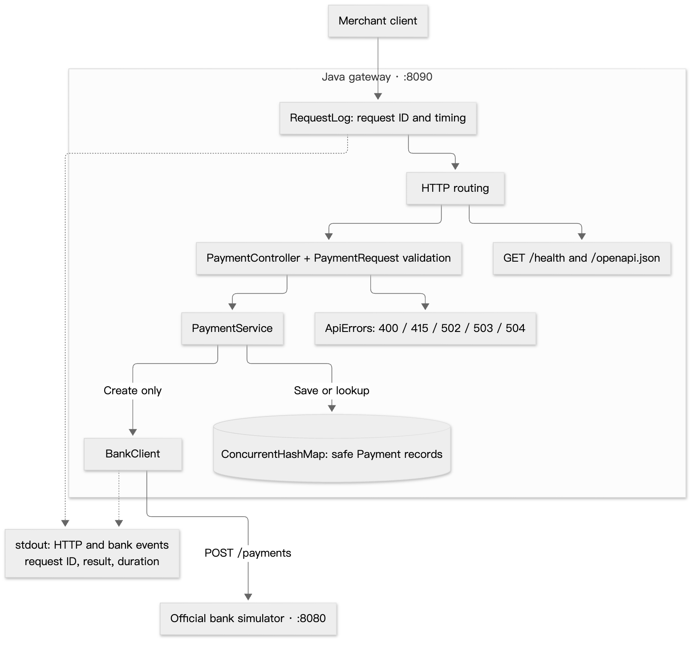
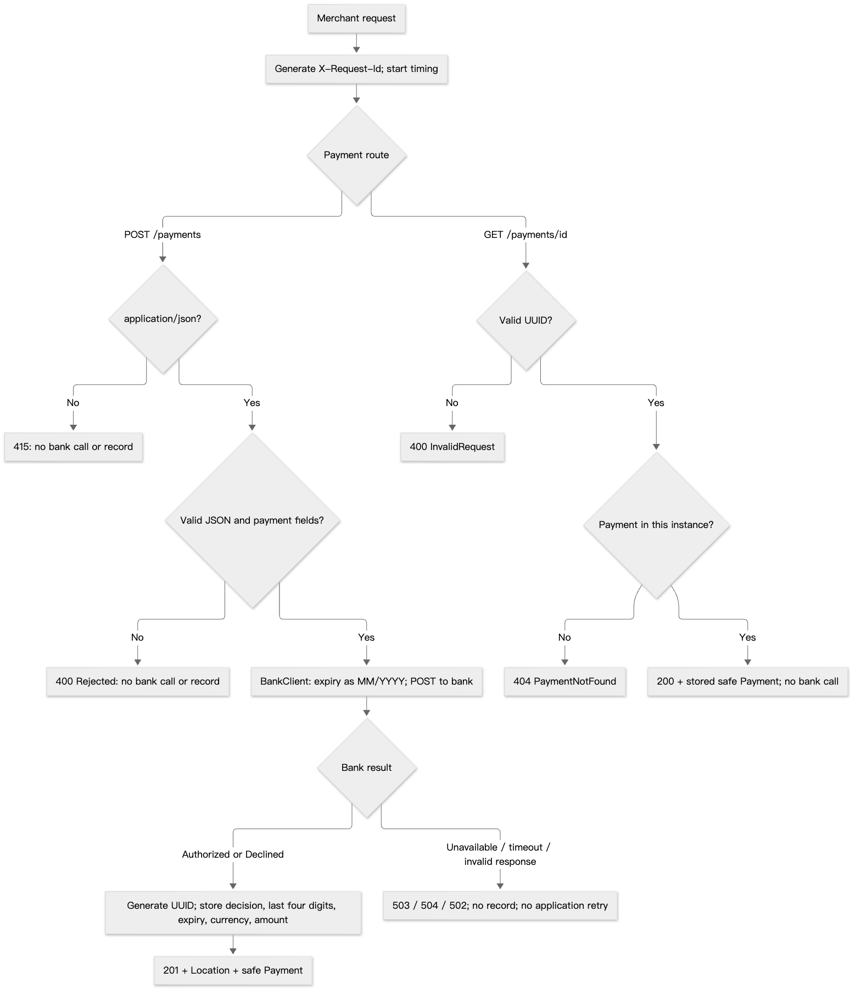

# Payment gateway

- Java 17 / Spring Boot; Python 3.12 / FastAPI alternative.
- `POST /payments`: validate, call the official bank simulator, store a masked result.
- `GET /payments/{id}`: retrieve that result from the same application.
- Shared API contract and black-box tests; independent processes and in-memory stores.

## Run Java

From the repository root, with Docker Engine/Desktop and Compose v2:

```sh
docker compose up --build --wait java
curl -fsS http://localhost:8090/health
curl -i http://localhost:8090/payments \
  -H 'Content-Type: application/json' \
  --data @tests/payment.json
```

- Expect `201 Authorized` and `Location`. Replace `<id>` with the returned ID to retrieve the same result:

```sh
curl -i "http://localhost:8090/payments/<id>"
```

- Other payloads: [declined](demo/declined.json) → `201 Declined`; [rejected](demo/rejected.json) → `400`; [bank unavailable](demo/bank-unavailable.json) → `503`.
- Run both versions: `docker compose up --build --wait`. Stop: `docker compose down`.
- [Compose config](compose.yaml): Java depends on the bank; Python is optional when starting `java`.
- Make shortcuts: `make up-java`, `make status`, `make logs`, `make down`. `make up` starts both versions.
- Localhost ports: Java `8090`, Python `8091`, bank `8080`, simulator admin `2525`.

## API

| Request or outcome | Response |
|---|---|
| POST, bank authorized or declined | 201 + payment + Location; both decisions are stored |
| Invalid payment or malformed JSON | 400 Rejected; no bank call or record |
| Unsupported Content-Type | 415; no bank call or record |
| GET /payments/{id} | 200; unknown ID 404; invalid UUID 400 |
| Bank unavailable / timeout / invalid response | 503 / 504 / 502; no record |
| GET /health | 200; application liveness only |

- Card: 14–19 digits. CVV: 3–4 digits. Strings preserve leading zeros.
- Expiry: month 1–12, year 1–9999; combined date after the current UTC month.
- Currency: USD, GBP or EUR. Amount: positive integer minor units.
- Strict JSON types; unknown fields rejected. Amount bounds and expiry assumptions: [design decisions](docs/DESIGN.md).
- Stored and returned fields: ID, status, last four digits, expiry month/year, currency, amount. No full card number or CVV.
- [OpenAPI](docs/openapi.json): `/openapi.json`. Swagger UI: Python `/docs` only.

## Architecture



## Payment flow



- No application retries: the bank may have processed a timed-out payment. Its outcome can remain unknown.

## Tests

Java only, with JDK 17:

```sh
cd java
./gradlew test bootJar --no-daemon
```

Both versions, from the root; requires JDK 17, Python 3.12, uv and Node.js/npm:

```sh
make test   # Unit, API and socket tests; builds the Java JAR
make e2e    # Includes make test; starts both apps and the simulator
```

- E2E needs ports 8080, 2525, 8090 and 8091 free; started processes are cleaned up.
- Verified 2026-10-15: Java **81**, Python **157**, shared E2E **166** passed.
- CI builds both containers and checks HTTP behavior and logs. [Results](docs/VERIFICATION.md) · [Requirements coverage](docs/REQUIREMENTS.md).

## Without Docker

Requires JDK 17 and Node.js/npm. Set `JAVA_HOME`; start the simulator from the root:

```sh
npm ci --ignore-scripts
npm run bank
```

Start Java in a second terminal:

```sh
cd java
./gradlew bootRun
```

Optional Python alternative, with Python 3.12 and uv 0.11.28:

```sh
cd python
uv sync --locked
uv run uvicorn payment_gateway_api.app:app --host 127.0.0.1 --port 8091 --no-access-log
```

- Defaults: `BANK_URL=http://localhost:8080`, `BANK_TIMEOUT_SECONDS=2`.
- Java: `PORT=8090`. Python: uvicorn `--port`; use one worker for the process-local store.

## Logs and limits

- `X-Request-Id` correlates handled responses and API/bank logs: status/outcome, duration. Application logs omit bodies, full card numbers, CVVs and query strings.
- Memory only: restarts lose records; instances do not share them; storage grows until exit.
- No authentication, persistence, idempotency or reconciliation. Containers run as non-root; use synthetic data with the test simulator.
- [Java code map and deployment](docs/JAVA.md) · [Design decisions](docs/DESIGN.md) · [Official sources](docs/SOURCES.md).
