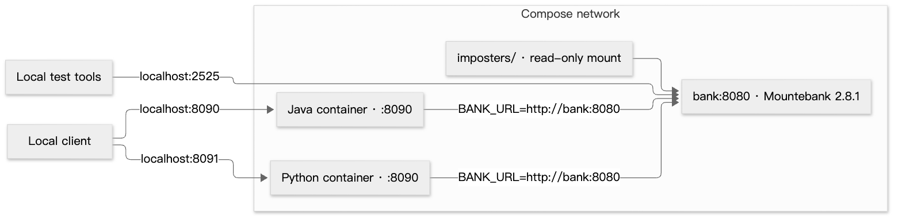

# Java implementation

## Starter compatibility

The [official Java starter](https://github.com/cko-recruitment/payment-gateway-challenge-java) permits changes to the solution structure and libraries. This repository keeps Java under `java/` and shares the simulator, API contract and black-box test cases with Python.

| Starter item | Location and choice |
|---|---|
| JDK 17, Spring Boot | Java 17 toolchain, Spring Boot 3.5.16 |
| Gradle project and wrapper | `java/build.gradle`, `java/gradlew`, `java/gradle/wrapper/`; Gradle 8.14.3 |
| Application sources | `java/src/main/java/com/checkout/payment/gateway/` |
| JUnit tests | `java/src/test/java/com/checkout/payment/gateway/` |
| `.editorconfig` | `java/.editorconfig`, unchanged |
| Bank configuration | `imposters/bank_simulator.ejs`, unchanged |
| Docker Compose | Root `compose.yaml`; adds both gateways to the supplied bank setup |
| API documentation | Shared `docs/openapi.json`, served by Java at `/openapi.json` |

The starter's `/swagger-ui/index.html` is not included. The OpenAPI contract is available as JSON; Python additionally provides `/docs`. The starter's singular payment path and mixed field naming are replaced by `/payments` and snake_case, as documented in [DESIGN.md](DESIGN.md). No compatibility aliases are needed for this exercise.

## Code path

All class links below are under `java/src/main/java/com/checkout/payment/gateway/`.

| Component | Responsibility |
|---|---|
| [GatewayApplication](../java/src/main/java/com/checkout/payment/gateway/GatewayApplication.java) | Starts Spring Boot; configures the HTTP client and strict JSON string handling |
| [RequestLog](../java/src/main/java/com/checkout/payment/gateway/RequestLog.java) | Generates `X-Request-Id`, puts it in MDC, logs status and duration, clears MDC |
| [PaymentRequest](../java/src/main/java/com/checkout/payment/gateway/PaymentRequest.java) | Required fields, numeric strings, bounds, currencies and future expiry |
| [PaymentController](../java/src/main/java/com/checkout/payment/gateway/PaymentController.java) | POST, GET, liveness endpoint and HTTP responses |
| [PaymentService](../java/src/main/java/com/checkout/payment/gateway/PaymentService.java) | Calls the bank, creates UUIDs and stores/retrieves safe immutable payments |
| [BankClient](../java/src/main/java/com/checkout/payment/gateway/BankClient.java) | Sends the five-field bank contract; parses the boolean decision; maps upstream failures |
| [Payment](../java/src/main/java/com/checkout/payment/gateway/Payment.java) | The seven response fields; no full card number or CVV |
| [ApiErrors](../java/src/main/java/com/checkout/payment/gateway/ApiErrors.java) | Fixed validation errors and technical bank error responses |
| [BankException](../java/src/main/java/com/checkout/payment/gateway/BankException.java) | Carries an expected upstream failure's HTTP status and error code |

POST validates before calling the bank. Both Authorized and Declined produce a stored payment and 201. Invalid input produces 400 without a bank call. Bank failures produce a technical error without a payment record. GET reads the same instance's map and never calls the bank.

The README diagrams cover these branches. `RequestLog` wraps all HTTP routes; both the HTTP event and any bank event share one request ID. The bank's authorization code is not part of the required response and is not retained. Shopper UI and merchant order handling are outside the gateway scope.

## Tests

From the repository root, with JDK 17 selected:

```sh
cd java
./gradlew clean test bootJar --no-daemon
```

| Suite | What it proves |
|---|---|
| `PaymentRequestTest` | Date boundary, valid card lengths/currencies, leading zeros and redacted request text |
| `PaymentServiceTest` | Both decisions, retrieval, upstream failure propagation and concurrent IDs |
| `PaymentApiTest` | Shared invalid-input matrix through Spring MVC; no bank call on rejection; HTTP responses, correlation and redaction |
| `BankClientTest` | Actual HTTP request serialization; bank decisions, malformed responses, no repeated calls, timeout and connection failure |

Test results: `java/build/reports/tests/test/index.html`. Coverage: `java/build/reports/jacoco/test/html/index.html`.

From the repository root, `make e2e` runs both suites, then starts Java, Python and the original simulator. Shared HTTP tests verify both real servers and their logs. It requires Node.js/npm, Python 3.12 and uv as well as Java. It stops the processes it started. See [requirements coverage](REQUIREMENTS.md) and [verification](VERIFICATION.md).

## Deploy and verify

Docker Engine/Desktop with Compose v2 is required. From the repository root, start Java and its bank dependency:

```sh
docker compose up --build --wait java
curl -fsS http://localhost:8090/health
curl -fsS http://localhost:8090/openapi.json
curl -i http://localhost:8090/payments \
  -H 'Content-Type: application/json' \
  --data @tests/payment.json
```

Copy the returned `Location` into a GET against `http://localhost:8090`. To start both implementations, use `docker compose up --build --wait`. Python is exposed at `http://localhost:8091`.

The root [compose.yaml](../compose.yaml) defines all three services. `make up-java` starts only Java and its bank dependency, with a 120-second health wait. `make up` starts both gateways. The bank check requires the configured port-8080 imposter to exist, not just a responding admin server.



The Java image builds an executable JAR with JDK 17 and runs it on a JRE as UID 10001. Python also runs as UID 10001. Both wait for the bank's health check before starting. Their own health checks probe application liveness. The simulator's admin API and all published ports bind to localhost.

| Setting | Default | Meaning |
|---|---|---|
| `BANK_URL` | `http://localhost:8080` locally; `http://bank:8080` in Compose | Bank base URL |
| `BANK_TIMEOUT_SECONDS` | `2` | Java connect/request timeout; Python network-phase timeout |
| `PORT` | `8090` | Java listen port; retain 8090 in Compose to match its health check and mapping |

Inspect and stop the stack:

```sh
docker compose ps
docker compose logs --tail=50 java bank
docker compose down
```

Shortcuts: `make status`, `make logs` (last 50 Java/bank log lines), and `make down`.

If startup reports an occupied port, check `docker compose ps` and `lsof -nP -iTCP:8090 -sTCP:LISTEN`. A locally running JAR uses the same port as Compose; run one stack at a time. Stopping or recreating a gateway loses its in-memory payments, so create a new payment before demonstrating GET.

Without Docker, start the simulator with `npm ci --ignore-scripts` and `npm run bank`. In another terminal, run `cd java && ./gradlew bootRun`, or run `java -jar java/build/libs/payment-gateway.jar` from the repository root after building.

This deploys a local exercise backend. It is not an Internet-facing payment service: authentication, TLS termination, durable storage, idempotency and reconciliation are absent. Restarting a gateway loses its records. The two gateways never share state.
